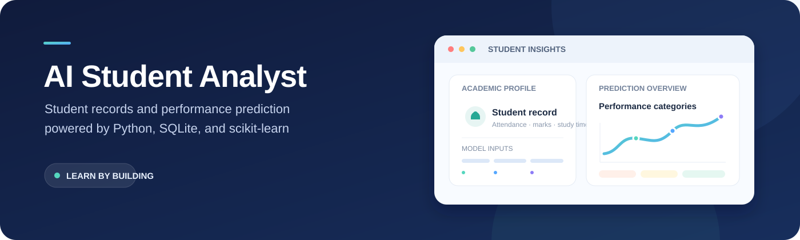

<p align="center">
  
</p>

<p align="center">
  <strong>A beginner-friendly Python + SQLite student management app with a scikit-learn Decision Tree demo.</strong>
</p>

<p align="center">
  <a href="https://github.com/abhiMhere/student-spoon"></a>
  <a href="https://github.com/abhiMhere/student-spoon"></a>
  <a href="https://github.com/abhiMhere/student-spoon"></a>
  <a href="LICENSE"></a>
</p>

<p align="center">
  <a href="#getting-started">Get started</a> ·
  <a href="#features">Features</a> ·
  <a href="#how-the-model-works">Model details</a> ·
  <a href="#responsible-use">Responsible use</a>
</p>

---

## Overview

AI Student Analyst lets you manage student records from a command-line menu and demonstrate a machine learning workflow. It stores records in SQLite and predicts one of three performance categories from previous marks, attendance, and daily study hours.

> **Dataset disclaimer:** The included `synthetic_student_performance.csv` is generated synthetic data. It does not contain real student records, and model metrics on it are not evidence of real-world accuracy.

## Features

| Area | What it does |
| --- | --- |
| Student records | Add, view, search, update, and delete records in SQLite |
| Predictions | Predict for a saved student or try new inputs without saving |
| Model evaluation | Print held-out accuracy, per-class metrics, and a confusion matrix |
| Validation | Check numeric ranges and required text inputs |
| Database compatibility | Add missing columns when opening an older database |
| Study suggestions | Show simple threshold-based suggestions alongside predictions |

## Getting started

### Requirements

- Python 3.10 or newer
- Internet access to install the Python dependencies

### Windows (PowerShell)

Clone the repository and open its root folder:

```powershell
git clone https://github.com/abhiMhere/student-spoon.git
cd .\student-spoon
```

Create and activate a virtual environment, install dependencies, and start the app:

```powershell
py -m venv .venv
.\.venv\Scripts\Activate.ps1
python -m pip install -r requirements.txt
python main.py
```

If PowerShell blocks the activation script, either allow it for this terminal session:

```powershell
Set-ExecutionPolicy -Scope Process -ExecutionPolicy Bypass
.\.venv\Scripts\Activate.ps1
```

Or use Command Prompt activation instead:

```bat
.venv\Scripts\activate.bat
```

### macOS / Linux

```bash
python3 -m venv .venv
source .venv/bin/activate
python -m pip install -r requirements.txt
python main.py
```

The app uses the included CSV by default and creates a reproducible synthetic dataset if it is missing. A local `students.db` database is created automatically the first time the app runs. Both the virtual environment and database are excluded from Git.

## Using the app

Choose an item at the main menu:

| Option | Action |
| --- | --- |
| 1 | Add a student |
| 2 | View all students |
| 3 | Search by name |
| 4 | Update a student |
| 5 | Delete a student |
| 6 | Predict for a saved student |
| 7 | Predict using new inputs |
| 8 | Evaluate the model |
| 9 | Exit |

For a quick prediction demo, choose **7** and enter previous marks `72`, attendance `85`, and study hours per day `3`. Choose **8** to print the evaluation for the held-out synthetic test split.

Example output shape:

```text
Predicted performance category: Average
Model probability for predicted category: <model output>
This probability is not a guarantee of real-world performance.
```

## How the model works

- **Inputs:** `previous_marks`, `attendance_percent`, `study_hours_per_day`
- **Output categories:** `Needs Support`, `Average`, `Strong`
- **Classifier:** `DecisionTreeClassifier(max_depth=5, min_samples_leaf=8, class_weight="balanced")`
- **Evaluation:** Stratified 75% training / 25% held-out test split with a fixed random seed
- **Reported metrics:** Accuracy, precision/recall/F1 by class, and confusion matrix

The synthetic labels are derived from a simulated score combining marks, attendance, study hours, and random noise. The evaluation is useful for demonstrating a workflow—not for estimating how well the model would perform on actual students.

## Project structure

```text
.
├── docs/
│   └── assets/
│       └── ai-student-analyst-banner.svg
├── DATASET_NOTE.txt
├── LICENSE
├── main.py
├── README.md
├── requirements.txt
├── synthetic_student_performance.csv
└── VIVA_PREPARATION.md
```

## Responsible use

- This is an educational prototype, not a decision-making tool.
- The predicted-class probability is a model estimate, not a guarantee or calibrated probability of success.
- Suggestions are simple rules, not personalized or AI-generated educational advice.
- Do not use this project for high-stakes decisions about students.
- Any real-world use would require a permissioned, representative dataset and careful evaluation.

## License

Released under the [MIT License](LICENSE).
